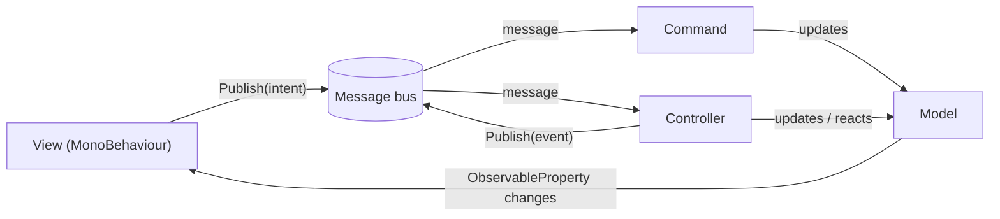

# GotoCore for Unity

A lightweight, message-driven **MVC framework for Unity**, with optional **[VContainer](https://github.com/hadashiA/VContainer)** dependency injection.

GotoCore started in 2017 as my own cross-language application framework (C#, TypeScript, Swift, ActionScript 3, Java, PHP, Python) built around named services and notifications. Version 2 keeps the idea (views send intents, commands and controllers do the work, models notify views) and rebuilds it for modern Unity: typed messages instead of string keys and parameter dictionaries, constructor injection instead of singletons, and a pure C# core that is easy to unit test.



| Piece | Type | Role |
|---|---|---|
| **Message** | plain `readonly struct` | an intent (`BuyRequested`) or an event (`LevelCompleted`) |
| **Message bus** | `IPublisher` / `ISubscriber` | typed, synchronous publish/subscribe |
| **Command** | `ICommand<TMessage>` | short-lived unit of work, created for every message |
| **Model** | plain class with `ObservableProperty<T>` | state and rules, no Unity, no messaging |
| **Controller** | `ControllerBase` | long-lived logic: reacts to messages and model changes, talks to services |
| **View** | `ViewBase : MonoBehaviour` | renders models, publishes intents; disposes its subscriptions on destroy |
| **Services** | `IAppContext`, `ILog`, `IFileStorage` | typed settings, logging with sinks, safe file access |

## Installation

Requires Unity **2021.3** or newer.

1. *(Optional, recommended)* install VContainer, e.g. via Package Manager → *Add package from git URL*:
   `https://github.com/hadashiA/VContainer.git?path=VContainer/Assets/VContainer`
2. Add GotoCore the same way:
   `https://github.com/varadig/GotoCoreCSharp.git`

The VContainer integration (`GotoCore.VContainer` assembly) compiles only when VContainer is installed, so the core works without it.

## Quick start with VContainer

```csharp
// Messages
public readonly struct IncrementRequested { public IncrementRequested(int amount) => Amount = amount; public int Amount { get; } }

// Model
public sealed class CounterModel
{
    private readonly ObservableProperty<int> _count = new ObservableProperty<int>(0);
    public IReadOnlyObservableProperty<int> Count => _count;
    public void Set(int value) => _count.Value = Math.Max(0, value);
}

// Command: a new instance per message, dependencies injected
public sealed class IncrementCommand : ICommand<IncrementRequested>
{
    private readonly CounterModel _model;
    public IncrementCommand(CounterModel model) => _model = model;
    public void Execute(IncrementRequested m) => _model.Set(_model.Count.Value + m.Amount);
}

// View
public sealed class CounterView : ViewBase
{
    [SerializeField] private Button button;
    [SerializeField] private Text label;

    [Inject]
    public void Construct(IPublisher publisher, CounterModel model)
    {
        button.onClick.AddListener(() => publisher.Publish(new IncrementRequested(1)));
        Track(model.Count.Subscribe(v => label.text = v.ToString()));
    }
}

// Composition root
public sealed class GameLifetimeScope : GotoCoreLifetimeScope
{
    protected override void ConfigureScope(IContainerBuilder builder)
    {
        builder.Register<CounterModel>(Lifetime.Singleton);
        builder.RegisterCommand<IncrementRequested, IncrementCommand>();
        builder.RegisterController<CounterController>();   // ControllerBase subclass, Initialize() called after build
        builder.RegisterComponentInHierarchy<CounterView>();
    }
}
```

`GotoCoreLifetimeScope` registers the message bus (`IMessageBus`, `IPublisher`, `ISubscriber`), `IAppContext` and `ILog` (with a Unity console sink). If you prefer your own scope class, call `builder.RegisterGotoCore(o => o.AddLogSink(new UnityLogSink()))` in a regular `LifetimeScope`. Register GotoCore once in the root scope; child scopes then share the same bus.

The complete example (model, two commands, a controller that saves to disk and publishes milestones, a uGUI view) is in **Package Manager → GotoCore → Samples → Counter**. To try it: import the sample, create a Canvas with two Buttons and two Texts, add `CounterView` and assign them, then add `CounterLifetimeScope` to an empty GameObject and press Play.

## Without a DI container

Everything in the core is plain C#:

```csharp
var bus = new MessageBus();
var model = new CounterModel();
var commands = new CommandMap(bus, type => new IncrementCommand(model))
    .Map<IncrementRequested, IncrementCommand>();

bus.Publish(new IncrementRequested(5));   // model.Count.Value == 5
commands.Dispose();
```

## Services

```csharp
// Typed settings, injected as IAppContext
public static class Keys { public static readonly ContextKey<string> ServerUrl = new ContextKey<string>("server.url"); }
context.Set(Keys.ServerUrl, "https://api.example.com");
string url = context.Get(Keys.ServerUrl);

// Logging: entries go to every sink (UnityLogSink, FileLogSink, MemoryLogSink, or your own ILogSink)
var log = injectedLog.ForCategory(nameof(ShopController));
log.Info("Purchase completed");

// File storage rooted at persistentDataPath; atomic writes, paths cannot escape the root
IFileStorage saves = UnityStorage.Persistent("saves");
saves.WriteText("slot1.json", json);
```

## Migrating from GotoCore 1.x

| 1.x | 2.x |
|---|---|
| `CoreServiceContainer.GetInstance()`, `Sc.RegisterService("name", fn)` | constructor injection (VContainer) |
| `Sc.GetService("name").AddParam(k, v).Execute()` | `publisher.Publish(new SomethingRequested(...))` + `ICommand<T>` |
| `CoreNotification` / `CoreListener` with string names | typed messages on `IPublisher` / `ISubscriber` |
| `CreateCallBack(group)` / callback groups | `ISubscriber.Subscribe<T>` or `ObservableProperty<T>.Subscribe` |
| `CoreContext.GetInstance().GetParam("key")` | `IAppContext.Get(ContextKey<T>)` |
| `CoreLogger` + `CoreLoggerDebug` / `CoreLoggerFile` / `CoreLoggerServer` | `ILog` + `UnityLogSink` / `FileLogSink` / custom `ILogSink` |
| `CoreFilesystem` services | `IFileStorage` (`FileStorage`, `UnityStorage.Persistent`) |
| `CoreGame` (XNA / MonoGame) | `GotoCoreLifetimeScope` + controllers |

The 1.x source is kept under the git tag `legacy-2017`.

## Tests

The core has NUnit edit-mode tests. To run them from a project, add the package to `testables` in `Packages/manifest.json`:

```json
"testables": ["com.varadig.gotocore"]
```

then open **Window → General → Test Runner → EditMode**.

## Project layout

```
Runtime/Core        GotoCore.Runtime     pure C#, no UnityEngine (messaging, commands, model, MVC, context, logging, storage)
Runtime/Unity       GotoCore.Unity       ViewBase, UnityLogSink, UnityStorage
Runtime/VContainer  GotoCore.VContainer  RegisterGotoCore / RegisterCommand / RegisterController, GotoCoreLifetimeScope
Samples~/Counter                         MVC + VContainer example
Tests/Editor        GotoCore.Tests.Editor
```
